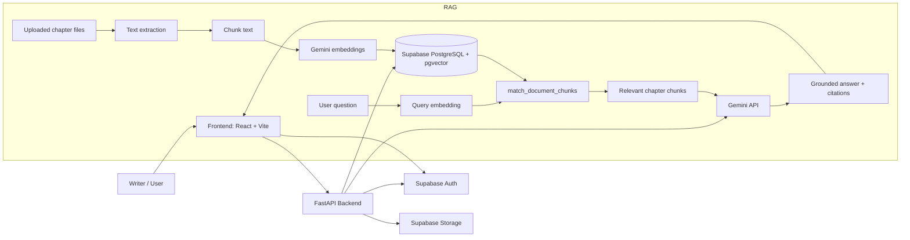
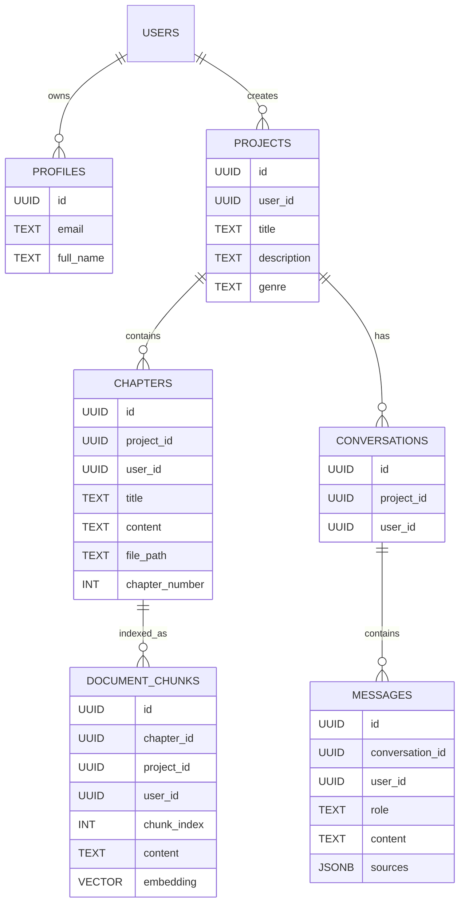

# StoryForge AI

<p align="center">
  
  
  
  
  
  
</p>

A storytelling workspace built for long-form fiction writers who need persistent memory, structured project management, and AI support grounded in their own chapters.

StoryForge AI helps authors organize story projects, upload chapters, index narrative content for semantic search, and ask grounded questions about their fictional universe without losing continuity across long writing arcs. The current implementation is the Release 1 MVP: a working core platform centered on project management, chapter ingestion, vector-based retrieval, and RAG-powered story chat with source citations.

## Why StoryForge AI

StoryForge AI is designed around a simple but high-value idea: writers do not just need a chatbot — they need a memory system for their story world. Great fictional worlds accumulate dozens of chapters, character details, lore, timelines, and unresolved plot threads. Existing general-purpose AI tools often hallucinate missing facts or lack a persistent understanding of the writer's private universe.

This project solves that by creating a project-scoped memory layer over a writer's uploaded chapters. It stores chapter text, chunks it into retrievable passages, embeds those passages, and retrieves the most relevant sections when the writer asks a question. Answers are generated using the retrieved story context, and source citations make the reference path clear.

## Release status

This repository currently implements the Release 1 stack:

- Core platform + project management
- Chapter upload and chapter content ingestion
- Text extraction from `.txt` and `.pdf` files
- Chapter chunking and Generative AI embedding creation
- Vector storage in Supabase/PostgreSQL with pgvector
- Semantic retrieval across project chapters
- RAG-powered chat grounded in retrieved story context
- Source citations and conversation history

Release 2 features are planned in the roadmap and are not implemented in this codebase.

## 1. Problem Statement

Fiction writers and authors face a set of recurring problems that become much harder at scale:

- Large story worlds are difficult to track across chapter boundaries.
- Important details are easy to forget after several drafts or arcs.
- Long-running narratives require continuity checks across character arcs, settings, timelines, and lore.
- Searching through previous chapters manually is slow and error-prone.
- General AI assistants often invent facts or respond with plausible but unsupported information.
- Writers need a system that remembers their own universe and can answer grounded questions about it.

A specialized storytelling assistant is needed because the writer's world is personal, iterative, and often contains unstructured narrative knowledge spread across chapters. The solution has to be context-aware, persistent, and anchored to the author's own source material.

## 2. Proposed Solution

StoryForge AI addresses these problems with a project-based editorial workflow:

- Users create a story project and keep work scoped to that universe.
- Chapters can be created manually or uploaded as text/PDF files.
- Story content is extracted and normalized for indexing.
- The backend splits long chapter text into smaller chunks.
- Gemini embeddings are generated for each chunk.
- Embeddings are stored in PostgreSQL using pgvector for semantic search.
- Users ask natural-language questions about their story.
- Relevant passages are retrieved using vector similarity.
- The model responds using only the retrieved context and cites the corresponding sources.

This is a classic RAG pattern adapted for fiction writing: rather than asking a model to remember everything from memory, the app grounds answers in the writer's actual chapters and narrative content.

## 3. Key Features — Release 1

The following features are implemented and verified in the current repository:

### User authentication

The frontend uses Supabase Auth for email/password sign-in and sign-up. The backend validates bearer tokens against the Supabase Auth service at `/api/auth/me` and authorizes project, chapter, and chat actions by user.

### Story project management

Users can create, list, update, and delete story projects. Each project is associated with a user and stores metadata such as title, description, and genre.

### Chapter management

Each project owns chapters. Chapters can be created manually, updated, listed, and deleted. The schema enforces ownership and project-level scope.

### PDF and TXT upload

The upload route accepts a chapter file and extracts text using a backend parser. Supported file types are plain text and PDF. The original file is stored in the Supabase Storage bucket `story-chapters`.

### Text extraction and normalization

Uploaded chapter files are parsed into extracted text. The implementation normalizes line breaks and strips invalid formatting before indexing.

### Document chunking

The RAG chunker splits long chapters into overlapping text segments with boundaries that prefer paragraph and sentence breaks. This keeps context windows relevant while preserving continuity.

### Gemini embedding generation

The backend calls the Gemini embedding model to turn text chunks into fixed-dimension vectors (`EMBEDDING_DIMENSIONS=768` by default).

### pgvector storage

The database migrations enable the pgvector extension and create a `document_chunks` table that stores text plus a vector embedding. A custom RPC function, `match_document_chunks`, performs semantic similarity search.

### Semantic retrieval

The `search_project_chunks` service converts the user question into an embedding and uses the vector search function to retrieve the most relevant passages from the writer's project.

### RAG-powered story chat

The backend chat route verifies project ownership, searches relevant chunks, and passes the retrieved content to Gemini to generate a grounded answer.

### Source citations

Assistant responses include source metadata with `chapter_id`, `chunk_index`, `chunk_id`, and similarity score. The UI renders these as citations alongside the answer.

### Persistent chat history

Each project can have multiple conversations, and messages are stored with role metadata and source references for later review.

### Project-scoped story memory

The retrieval system is scoped to a single project, preventing cross-project leakage and preserving user isolation.

## 4. Application Workflow

The user journey in StoryForge AI is intentionally simple:

1. A user signs up or logs in with Supabase Auth.
2. The user creates a story project.
3. The user uploads one or more story chapters as `.txt` or `.pdf` files.
4. The backend extracts the document text and saves the original file to Supabase Storage.
5. The chapter content is split into overlapping chunks.
6. Gemini generates embeddings for each chunk.
7. The embeddings are stored in Supabase PostgreSQL using the `public.document_chunks` table and pgvector.
8. The user asks a question about the story, such as a lore request, continuity question, or character detail.
9. The question is converted into an embedding using the Gemini retrieval-query model.
10. The backend retrieves the most relevant chapter chunks using similarity search.
11. The retrieved passages are inserted into the Gemini prompt as grounded context.
12. Gemini answers using the relevant story content and avoids unsupported claims.
13. The response includes source references pointing back to the chapter chunks that supported it.

This makes the assistant behave more like a story-aware research tool than a generic chatbot.

## 5. System Architecture

The repository implements a classic client-server architecture with a React frontend, a FastAPI backend, Supabase for identity and persistence, and Gemini for generative AI and embeddings.



### Responsibilities by component

- Frontend: project creation, chapter editing, upload UI, story assistant UI, state management
- Backend: request validation, auth verification, project/chapter APIs, retrieval orchestration, grounding prompt generation
- Authentication: Supabase Auth with bearer-token validation by FastAPI
- Database: stores projects, chapters, conversations, messages, and vectorized chapter chunks
- Vector search: performed with pgvector HNSW index and PostgreSQL RPC functions
- File storage: original chapters stored in the private `story-chapters` storage bucket
- AI model: Gemini generates responses using retrieved context and reads the system instruction for grounded behavior
- Embedding model: Gemini embedding model converts chapter chunks and questions into vectors

## 6. Technology Stack

| Technology | Purpose | How it is used in StoryForge AI |
| --- | --- | --- |
| React 19 | Frontend UI | Main app shell and interactive writer experience |
| Vite | Frontend build tool | Serves the client app locally and builds the production bundle |
| TypeScript | Type safety | Provides typed project and API models in the frontend |
| Tailwind CSS | Styling | UI styling for dashboard, studio, and assistant views |
| Python | Backend runtime | Hosts the FastAPI API and processing logic |
| FastAPI | API framework | Handles REST endpoints, validation, CORS, and auth checks |
| Pydantic | Validation | Validates project, chapter, and chat payloads |
| Supabase Auth | Identity | Manages sign-in, sign-up, session management, and bearer-token verification |
| Supabase PostgreSQL | Primary persistence | Stores projects, chapters, conversations, messages, and vectors |
| pgvector | Vector search | Stores and compares text embeddings for semantic retrieval |
| Supabase Storage | File hosting | Keeps uploaded chapter files in a private bucket |
| Gemini API | LLM generation | Produces grounded responses for the story assistant |
| Gemini Embedding API | Embeddings | Converts story text and questions into search vectors |
| `httpx` | HTTP client | Verifies Supabase JWT tokens in backend auth |
| `python-multipart` | File uploads | Enables chapter upload forms in FastAPI |
| `pypdf` | PDF extraction | Extracts text from uploaded PDF chapters |

## 7. RAG Architecture — Core Technical Innovation

StoryForge AI is a Retrieval-Augmented Generation application built specifically for story worlds.

### Document ingestion

When a user uploads a chapter, the backend validates the file, extracts readable text, and stores the raw file in Supabase Storage. The extracted text is saved as chapter content in the database and then queued for indexing.

### Text chunking

Large chapters are split into shorter, overlapping chunks. This is important because long texts exceed model context limits and become less precise when used as a single retrieval target. Chunking lets the system retrieve the most relevant passage rather than an entire chapter.

### Embedding generation

Each chunk is converted into a vector using the Gemini embedding model with a fixed output dimension. The chunk text and its vector are stored together, enabling similarity search over narrative content.

### Vector storage

The `document_chunks` table stores `content` and `embedding` columns. The database migration creates an HNSW index on the vector column with cosine distance for efficient approximate nearest-neighbor retrieval.

### Semantic retrieval

When the user asks a question, the backend embeds the question and runs the `match_document_chunks` function. The database returns the top-scoring chapter chunks for that project and user, ordered by semantic similarity.

### Context-aware generation

The retrieved chunks are inserted into a prompt with the user question and explicit instructions to answer only with supported narrative facts. The model is prevented from inventing details by using a grounded prompting setup and a strict system message.

### Source citations

Each retrieved chunk is mapped to a source ID like `[S1]`, `[S2]`, etc. The final answer cites those identifiers, and the UI can show the related chapter and chunk metadata for traceability.

```mermaid
flowchart TD
    A[Uploaded chapter text] --> B[Chunking]
    B --> C[Generate embedding]
    C --> D[Store chunk + embedding in pgvector]
    E[User question] --> F[Embed question]
    D --> G[Semantic match on project chunks]
    F --> G
    G --> H[Top relevant story passages]
    H --> I[Gemini grounded response]
    I --> J[Answer with [S1], [S2] citations]
```

This architecture is especially useful for long-form storytelling because it lets a writer ask, “What do we know about this character?,” “Which chapter mentions the city?” or “Was this event previously established?” and receive answers grounded in the writer's own chapters rather than generic model memory.

## 8. Database Design

The implemented database schema is a project-owned relational model with row-level security and vector indexing.

### Core tables

- `public.profiles`: stores per-user profile data linked to Supabase `auth.users`
- `public.projects`: stores story projects per authenticated user
- `public.chapters`: stores chapter metadata and content, and enforces project ownership
- `public.document_chunks`: stores embedded text chunks and a vector embedding per project chapter
- `public.conversations`: stores discussion threads per project
- `public.messages`: stores user and assistant messages with `sources` JSON metadata

### Relationships

- One user has many projects.
- One project has many chapters.
- One chapter has many document chunks.
- One project has many conversations.
- One conversation has many messages.

### Security model

The schema enables Row Level Security (RLS) and creates policies so authenticated users can only manage their own data. Project, chapter, and conversation records enforce ownership with foreign keys and explicit user checks. The RAG RPC functions verify ownership before matching or replacing chunks.

### Storage design

The `story-chapters` bucket is private and stores user files under a path that includes the user ID and project ID. Access policies restrict uploads, reads, updates, and deletes to the authenticated owner.

### ER diagram



## 9. Project Structure

```text
StoryForge-AI/
├── README.md
├── LICENSE
├── backend/
│   ├── .env.example
│   ├── .venv/
│   ├── pytest.ini
│   ├── requirements.txt
│   ├── app/
│   │   ├── core/
│   │   │   ├── config.py
│   │   │   └── security.py
│   │   ├── models/
│   │   │   ├── chapter.py
│   │   │   ├── chat.py
│   │   │   └── project.py
│   │   ├── rag/
│   │   │   ├── chunker.py
│   │   │   └── indexer.py
│   │   ├── routes/
│   │   │   ├── auth.py
│   │   │   ├── chapters.py
│   │   │   ├── chat.py
│   │   │   ├── conversations.py
│   │   │   ├── dashboard.py
│   │   │   └── projects.py
│   │   ├── services/
│   │   │   ├── chapter_service.py
│   │   │   ├── chat_service.py
│   │   │   ├── conversation_service.py
│   │   │   ├── dashboard_service.py
│   │   │   ├── document_chunk_service.py
│   │   │   ├── embedding_service.py
│   │   │   ├── message_service.py
│   │   │   ├── project_service.py
│   │   │   ├── retrieval_service.py
│   │   │   └── supabase_service.py
│   │   ├── utils/
│   │   │   └── file_parser.py
│   │   ├── main.py
│   │   └── __init__.py
│   ├── supabase/
│   │   └── migrations/
│   │       ├── 001_enable_pgvector.sql
│   │       ├── 002_initial_schema.sql
│   │       ├── 003_storage.sql
│   │       └── 004_rag_rpc_functions.sql
│   └── tests/
│       ├── conftest.py
│       ├── test_api_e2e.py
│       ├── test_auth_security.py
│       ├── test_file_parser.py
│       ├── test_production_config.py
│       └── test_rag_services.py
├── frontend/
│   ├── .env.example
│   ├── package.json
│   ├── index.html
│   ├── src/
│   │   ├── assets/
│   │   ├── components/
│   │   │   ├── AuthGate.tsx
│   │   │   ├── ChapterEditor.tsx
│   │   │   ├── ProjectEditor.tsx
│   │   │   ├── StoryAssistant.tsx
│   │   │   ├── storyforge/
│   │   │   └── ui/
│   │   ├── hooks/
│   │   │   └── useStoryforge.ts
│   │   ├── lib/
│   │   │   ├── api/
│   │   │   ├── auth/
│   │   │   └── supabase/
│   │   ├── services/
│   │   │   └── storyforge.ts
│   │   ├── types/
│   │   │   └── api.ts
│   │   ├── App.tsx
│   │   ├── index.css
│   │   └── main.tsx
│   └── dist/
└── frontend/node_modules/
```

## 10. API Documentation

All backend routes are mounted under `/api`.

| Method | Endpoint | Purpose | Authentication |
| --- | --- | --- | --- |
| GET | `/` | Root service status | No |
| GET | `/health` | Health check | No |
| GET | `/api/auth/me` | Validate current bearer token and return user profile | Yes |
| POST | `/api/projects/` | Create a project | Yes |
| GET | `/api/projects/` | List current user's projects | Yes |
| GET | `/api/projects/{project_id}` | Fetch one project | Yes |
| PATCH | `/api/projects/{project_id}` | Update project metadata | Yes |
| DELETE | `/api/projects/{project_id}` | Delete a project | Yes |
| POST | `/api/projects/{project_id}/chapters` | Create a chapter in a project | Yes |
| GET | `/api/projects/{project_id}/chapters` | List chapters in a project | Yes |
| GET | `/api/chapters/{chapter_id}` | Fetch one chapter | Yes |
| PATCH | `/api/chapters/{chapter_id}` | Update chapter metadata or content | Yes |
| DELETE | `/api/chapters/{chapter_id}` | Delete a chapter | Yes |
| POST | `/api/projects/{project_id}/chapters/upload` | Upload a `.txt` or `.pdf` chapter and ingest it | Yes |
| POST | `/api/projects/{project_id}/chat` | Ask a story question and receive grounded answer | Yes |
| GET | `/api/projects/{project_id}/conversations` | List project conversations | Yes |
| GET | `/api/conversations/{conversation_id}/messages` | Fetch messages in one conversation | Yes |
| GET | `/api/dashboard/overview` | Return project and chat overview stats | Yes |

## 11. Installation and Local Setup

### Prerequisites

- Python 3.12+
- Node.js 20+
- npm
- A Supabase project with PostgreSQL enabled
- A Gemini API key
- A configured `story-chapters` storage bucket in Supabase

### 1. Clone the repository

```bash
git clone https://github.com/adityashukla15/StoryForge-AI.git
cd StoryForge-AI
```

### 2. Backend setup

```bash
cd backend
python -m venv .venv
./.venv/Scripts/Activate.ps1   # PowerShell
# or
source .venv/bin/activate       # macOS/Linux
pip install -r requirements.txt
```

Create a local environment file based on the sample:

```bash
cp .env.example .env
```

Then populate the values in `.env`.

### 3. Apply Supabase database migrations

The project ships with migration SQL files under `backend/supabase/migrations/`. Apply them in order to your Supabase project database:

```sql
-- 001_enable_pgvector.sql
-- 002_initial_schema.sql
-- 003_storage.sql
-- 004_rag_rpc_functions.sql
```

These migrations enable the vector extension, create tables, enable row-level security, and add the retrieval RPC functions used by the backend.

### 4. Frontend setup

```bash
cd ../frontend
npm install
cp .env.example .env
```

### 5. Start the backend

```bash
cd ../backend
uvicorn app.main:app --reload --host 0.0.0.0 --port 8000
```

### 6. Start the frontend

```bash
cd ../frontend
npm run dev
```

The frontend expects the backend at `http://localhost:8000/api` by default, and the app uses Supabase Auth for session handling.

## 12. Environment Variables

The application expects the following environment values.

### Backend (`backend/.env`)

```env
APP_NAME=StoryForge AI API
APP_ENV=development
API_PREFIX=/api
ALLOWED_ORIGINS=http://localhost:3000

SUPABASE_URL=https://your-project.supabase.co
SUPABASE_ANON_KEY=your-anon-key
SUPABASE_SERVICE_ROLE_KEY=your-service-role-key

GEMINI_API_KEY=your-gemini-api-key
GEMINI_MODEL=gemini-2.5-flash
GEMINI_EMBEDDING_MODEL=gemini-embedding-001
EMBEDDING_DIMENSIONS=768
```

### Frontend (`frontend/.env`)

```env
VITE_API_BASE_URL=http://localhost:8000/api
VITE_SUPABASE_URL=https://your-project.supabase.co
VITE_SUPABASE_ANON_KEY=your-anon-key
```

Important notes:

- Do not commit real credentials or secrets.
- The backend enforces production-only environment validation for Supabase URLs and CORS origin rules.
- The app requires both a valid Supabase Auth session and a valid backend environment to function.

## 13. Current Scope and Roadmap

This codebase implements the MVP and not the full future vision described in a broader storytelling platform roadmap. The current repository focuses on:

- story project management
- chapter ingestion and indexing
- semantic memory retrieval
- chat grounded on uploaded chapters
- project-scoped story continuity support

The broader relational, character graph, continuity lab, world-building, and AI story intelligence features represented in the UI shell are not yet fully implemented as backend services or production-ready product capabilities.

## 14. License

This project is licensed under the MIT License. See [LICENSE](LICENSE) for details.


